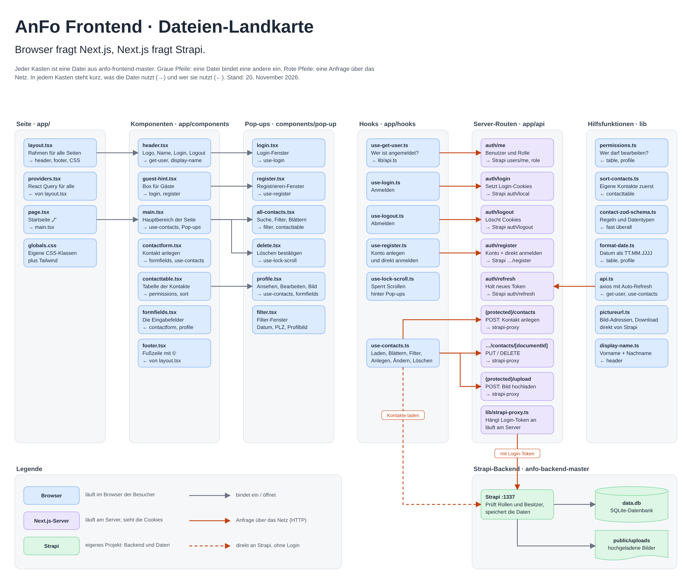

ANFO – Kontaktverwaltung (Frontend)

Die Benutzeroberfläche der ANFO-Kontaktverwaltung, gebaut mit Next.js, React, TypeScript und Tailwind CSS. Sie zeigt Kontakte an, kümmert sich um Login und Registrierung und schickt Änderungen an das Strapi-Backend.

Zugehöriges Backend: https://github.com/RaByteCell/anfo-backend-master

Stand: 20. November 2026

Inhalt
Überblick
Wichtig: Abgleich mit GitHub
Funktionen
Technik
Installation und Start
Konfiguration
Projektstruktur
Wie die Daten fließen
Login und Tokens
Berechtigungen
Was gemacht wurde und warum
Bekannte Grenzen und Hinweise
Nützliche Befehle

1. Überblick
   text
   Browser → Next.js (dieses Projekt, Port 3000) → Strapi (Backend, Port 1337)

Das Frontend besteht aus zwei Teilen, die beide in diesem Projekt liegen:

Was im Browser läuft: Seiten, Formulare, Tabellen, Pop-ups (app/components/) und die Hooks, die Daten laden (app/hooks/).
Was auf dem Next.js-Server läuft: die Routen unter app/api/. Sie lesen das Login-Token aus einem geschützten Cookie, hängen es an und schicken die Anfrage an Strapi weiter.

Kontakte lesen geht direkt vom Browser an Strapi, weil das jeder darf. Alles, was einen Login braucht, läuft über die Routen in app/api/.

### Landkarte der Dateien

2. Wichtig: Abgleich mit GitHub

Der letzte Commit auf GitHub ist vom 20. November 2026 um 07:20. Danach wurde lokal noch einiges geändert. Vor dem nächsten Commit prüfen, ob diese Änderungen dabei sind:

Datei Änderung
lib/contacts.ts → app/hooks/general/use-contacts.ts verschoben und umbenannt, dazu Blättern, Filter und eigene Kontakte zuerst
app/components/pop-up/filter.tsx neu: Filter-Pop-up
app/components/pop-up/all-contacts.tsx Blättern mit Knöpfen, Filter, eigene Kontakte zuerst
app/components/pop-up/edit.tsx löschen, wird nicht mehr verwendet
app/components/contacttable.tsx feste Spaltenbreiten, lange Werte mit „…“, eigene Zeilen blau
app/components/main.tsx eigene Kontakte haben auf der Startseite Vorrang
lib/display-name.ts neu: Anzeigename aus Vor- und Nachname
app/components/header.tsx zeigt den Anzeigenamen
app/api/auth/register/route.ts Zufallskennung als Benutzername, danach direkt anmelden
app/hooks/auth/use-register.ts, use-get-user.ts Felder vorname, nachname, role
app/components/pop-up/register.tsx schickt Vor- und Nachname, schließt sich nach Erfolg
lib/pictureurl.ts Import von API_URL aus dem neuen Ort

.env.local gehört nicht auf GitHub. Das ist in .gitignore bereits so eingestellt (.env\*).

3. Funktionen
   Für Gäste (nicht angemeldet)
   Startseite mit den 4 neuesten Kontakten
   Adresse, PLZ, E-Mail und Geburtsdatum verschwommen und nicht markierbar
   Statt des Formulars eine Box „Kontakte verwalten“ mit Anmelden und Registrieren
   Profilbilder sind nicht anklickbar, „Alle Kontakte“ ist nicht verfügbar
   Für angemeldete Benutzer
   Kontakt anlegen über das Formular. Der Kontakt gehört dann diesem Benutzer.
   Startseite: zuerst bis zu 4 eigene Kontakte, freie Plätze füllen die neuesten fremden
   Eigene Kontakte sind blau hinterlegt und durch die Linie „Weitere Kontakte“ von fremden getrennt
   Profil-Pop-up per Klick aufs Bild: großes Bild, Daten, Bild herunterladen
   Bearbeiten (im Profil oder über den Stift) mit Bild hochladen, nur bei eigenen Kontakten
   Löschen nur bei eigenen Kontakten
   „Alle Kontakte“: Suche, Filter (Geburtsdatum, PLZ, Profilbild), 10 pro Seite mit Zurück und Weiter, eigene Kontakte über alle Seiten hinweg zuerst
   Für die Rolle Admin
   Bearbeiten und Löschen bei allen Kontakten
   Konto
   Registrieren mit Vorname, Nachname, E-Mail und Passwort. Danach ist man sofort angemeldet.
   Gleiche Namen sind erlaubt, nur die E-Mail muss einmalig sein
   Im Header steht der Anzeigename („Vorname Nachname“)
   Die Anmeldung bleibt beim Neuladen erhalten, das Token wird automatisch erneuert
4. Technik
   Paket Version Wofür
   next 16.4.4 Seiten, Layout, Serverrouten
   react, react-dom 19.3.0 Oberfläche und Komponenten
   typescript 5.9.3 Typen
   tailwindcss 4.3.3 Gestaltung
   @tanstack/react-query 5.104.1 Laden und Zwischenspeichern von Daten
   axios 1.20.0 Anfragen an Strapi und die eigenen Routen
   react-hook-form 7.89.0 Formulare
   zod 4.6.5 Prüfregeln für Eingaben
   @hookform/resolvers 5.9.1 verbindet React Hook Form mit Zod
   lucide-react 1.65.0 Symbole

Die genauen Versionen stehen in package-lock.json. npm ci installiert genau diese.

Versionshinweis: eslint-config-next stammt noch aus der 14er-Reihe, next ist Version 16. Das sollte bei einem Update der ESLint-Einstellungen angeglichen werden.

5. Installation und Start
   Voraussetzungen
   Node.js 24 (siehe Backend-README, mit 26 scheitert die Installation des Backends)
   Das Strapi-Backend läuft unter http://localhost:1337, mit den Rollen und Rechten aus der Backend-README
   Installieren
   powershell
   git clone https://github.com/RaByteCell/anfo-frontend-master.git
   cd anfo-frontend-master
   npm ci
   Starten
   powershell
   npm run dev

Danach http://localhost:3000 öffnen.

Achtung: Das Terminal zeigt beim Start auch eine Adresse wie http://192.168.x.x:3000 („Network“). Die ist für andere Geräte im WLAN gedacht. Am eigenen PC immer localhost verwenden. Über die Network-Adresse blockiert Next.js im Entwicklungsmodus Teile der Seite, und der Login-Knopf erscheint nicht.

6. Konfiguration

Optional eine Datei .env.local im Projektordner:

env
NEXT_PUBLIC_API_URL=http://localhost:1337/api
STRAPI_URL=http://localhost:1337
Variable Wer nutzt sie Standard
NEXT_PUBLIC_API_URL der Browser, für Kontakte und Bilder http://localhost:1337/api
STRAPI_URL die Serverrouten in app/api/ http://localhost:1337

Werte mit NEXT*PUBLIC* sind im Browser sichtbar. Dort dürfen keine Geheimnisse stehen. Sie werden außerdem beim npm run build fest eingebaut. Nach einer Änderung muss man neu bauen.

7. Projektstruktur
   text
   app/
   ├── api/ # Serverrouten (laufen auf dem Next.js-Server)
   │ ├── auth/
   │ │ ├── login/route.ts # Anmelden, setzt Login-Cookies
   │ │ ├── logout/route.ts # Abmelden, beendet die Sitzung in Strapi
   │ │ ├── me/route.ts # Wer ist angemeldet? Mit Rolle
   │ │ ├── refresh/route.ts # neues Access-Token holen
   │ │ └── register/route.ts # Konto anlegen und direkt anmelden
   │ └── (protected)/ # nur zum Ordnen, erscheint nicht in der Adresse
   │ ├── contacts/route.ts # POST: Kontakt anlegen
   │ ├── contacts/[documentId]/route.ts # PUT, DELETE: bearbeiten, löschen
   │ └── upload/route.ts # POST: Bild hochladen
   ├── components/
   │ ├── main.tsx # Hauptbereich: Formular, Tabelle, Pop-ups
   │ ├── header.tsx, footer.tsx
   │ ├── contactform.tsx # Kontakt anlegen
   │ ├── formfields.tsx # Eingabefelder (Anlegen und Bearbeiten)
   │ ├── contacttable.tsx # Kontakttabelle
   │ ├── guest-hint.tsx # Box für Gäste statt Formular
   │ └── pop-up/
   │ ├── all-contacts.tsx # alle Kontakte: Suche, Filter, Blättern
   │ ├── filter.tsx # Filter-Fenster
   │ ├── profile.tsx # Profil ansehen und bearbeiten
   │ ├── delete.tsx # Löschen bestätigen
   │ ├── login.tsx, register.tsx
   ├── hooks/
   │ ├── auth/ # use-get-user, use-login, use-logout, use-register
   │ └── general/
   │ ├── use-contacts.ts # Kontakte laden, anlegen, ändern, löschen
   │ └── use-lock-scroll.ts # Scrollen hinter Pop-ups sperren
   ├── layout.tsx # Rahmen jeder Seite
   ├── page.tsx # Startseite
   ├── providers.tsx # React Query für die ganze App
   └── globals.css # eigene CSS-Klassen
   lib/
   ├── api.ts # axios, erneuert abgelaufene Tokens automatisch
   ├── strapi-proxy.ts # für Serverrouten: Anfrage mit Token an Strapi
   ├── contact-zod-schema.ts # Prüfregeln und Datentypen eines Kontakts
   ├── permissions.ts # Wer darf einen Kontakt verwalten?
   ├── sort-contacts.ts # eigene Kontakte zuerst
   ├── display-name.ts # Anzeigename eines Benutzers
   ├── format-date.ts # Datum als TT.MM.JJJJ
   └── pictureurl.ts # Bildadressen und Download
   Landkarte der Dateien

Wie die Dateien des Frontends zusammenhängen

Warum so viele einzelne Dateien?

Am Anfang stand fast alles in einer großen Datei. Sie wurde Schritt für Schritt aufgeteilt, nach der Regel eine Datei, eine Aufgabe:

Leichter zu verstehen. Eine Datei mit 50 Zeilen, die nur das Löschen bestätigt, versteht man schneller als 500 Zeilen, in denen alles durcheinander steht.
Fehler lassen sich schneller finden. Klappt das Filtern nicht, liegt der Fehler fast sicher in filter.tsx oder use-contacts.ts und nicht irgendwo im ganzen Projekt.
Einmal schreiben, mehrfach verwenden. formfields.tsx gibt es nur einmal, sie wird beim Anlegen und im Profil benutzt. contacttable.tsx erscheint auf der Startseite und in „Alle Kontakte“. Eine Änderung wirkt an beiden Stellen.
Änderungen bleiben klein. Wer das Filter-Fenster umbaut, muss die Tabelle nicht anfassen und kann dort auch nichts kaputt machen.
Zusammenarbeit wird einfacher. Arbeiten zwei Personen an verschiedenen Dateien, kommen sie sich in Git nicht in die Quere.

Der Preis dafür sind mehr Dateien und mehr import-Zeilen. Dafür gibt es die Landkarte oben.

Warum manche Dateien in hooks liegen und andere in lib

Entscheidend ist eine Frage: Ruft die Funktion selbst einen React-Hook auf, also etwas wie useState, useEffect, useQuery oder useMutation?

    app/hooks	lib

Was Funktionen, die React-Hooks verwenden normale Funktionen ohne React
Name beginnt mit use… beliebig
Wo nutzbar nur in Komponenten, ganz oben, nicht in if oder Schleifen überall: in Komponenten, in Hooks, auch in Serverrouten
Was sie tun sich etwas merken, Daten laden, auf Änderungen reagieren etwas hineingeben, etwas herausbekommen, wie eine Rechenaufgabe
Beispiele use-contacts.ts lädt mit React Query, use-get-user.ts fragt den Benutzer ab, use-lock-scroll.ts reagiert mit useEffect auf das Öffnen eines Pop-ups format-date.ts formatiert ein Datum, permissions.ts vergleicht Besitzer, sort-contacts.ts sortiert eine Liste, display-name.ts setzt den Namen zusammen

Warum diese Trennung wichtig ist:

Hooks haben strenge Regeln. React erkennt sie am use im Namen und prüft, ob sie richtig verwendet werden. Stünden sie zwischen normalen Funktionen, wäre das nicht mehr erkennbar.
lib-Funktionen funktionieren auch auf dem Server. strapi-proxy.ts wird von den Serverrouten in app/api verwendet. Dort gibt es kein React, ein Hook würde dort gar nicht funktionieren.
lib-Funktionen sind leicht zu prüfen. Gleiche Eingabe ergibt immer gleiche Ausgabe. getDisplayName mit „Max“ und „Muster“ liefert immer „Max Muster“.

Sonderfall api.ts: Die Datei richtet nur axios ein und enthält keinen Hook, deshalb liegt sie in lib, auch wenn sie hauptsächlich von Hooks benutzt wird.

Namensregeln im Projekt
page.tsx, layout.tsx, route.ts sind von Next.js vorgegeben und müssen genau so heißen.
[documentId]: eckige Klammern sind ein Platzhalter in der Adresse.
(protected): runde Klammern dienen nur zum Ordnen und tauchen in der Adresse nicht auf.
use-… heißen Dateien mit React-Hooks, also Funktionen, die selbst Hooks wie useQuery oder useState aufrufen. 8. Wie die Daten fließen
Kontakt anlegen
contactform.tsx prüft die Eingaben mit den Regeln aus contact-zod-schema.ts.
useCreateContact (in use-contacts.ts) schickt die Daten an /api/contacts.
Die Route hängt mit strapi-proxy.ts das Login-Token an und schickt alles an Strapi.
Strapi trägt den angemeldeten Benutzer als Besitzer ein und speichert.
React Query lädt alle Kontaktlisten neu.
Bearbeiten mit neuem Bild
profile.tsx zeigt eine Vorschau des gewählten Bildes.
Beim Speichern lädt useUpdateContact zuerst das Bild über /api/upload hoch und bekommt dessen ID.
Danach gehen die Daten samt Bild-ID an /api/contacts/[documentId].
Strapi prüft den Besitzer, speichert und löscht das alte Bild.
„Alle Kontakte“ laden

useContactsPage setzt jede Seite aus zwei Anfragen zusammen: zuerst die eigenen Kontakte (alphabetisch), danach die übrigen (neueste zuerst). Suche und Filter gelten für beide. Strapi liefert jeweils nur den benötigten Ausschnitt (pagination[start], pagination[limit]).

9. Login und Tokens
   Schritt Datei Was passiert
   Anmelden login/route.ts Strapi prüft E-Mail und Passwort. Access-Token (10 Min.) und Refresh-Token kommen als httpOnly-Cookies in den Browser.
   Wer bin ich? me/route.ts liest das Token aus dem Cookie, fragt Strapi nach Benutzer und Rolle
   Token abgelaufen lib/api.ts → refresh/route.ts Bei Fehler 401 wird automatisch ein neues Token geholt und die Anfrage wiederholt
   Abmelden logout/route.ts beendet die Sitzung in Strapi und löscht die Cookies
   Registrieren register/route.ts legt das Konto an (Benutzername: Zufallskennung) und meldet sofort an

Warum die Serverrouten? httpOnly-Cookies kann JavaScript im Browser nicht lesen, auch eingeschleuster fremder Code nicht. Nur der Next.js-Server kommt an das Token und kann es an Strapi weitergeben.

Im Produktionsbetrieb sind die Cookies secure. Der Login funktioniert dann nur über HTTPS.

10. Berechtigungen
    Gast Angemeldet Admin
    Kontakte sehen ✓ (Daten verschwommen) ✓ ✓
    Kontakt anlegen – ✓ ✓
    Bearbeiten, löschen, Bild hochladen – nur eigene alle
    Bild herunterladen – ✓ ✓
    Alle Kontakte, Suche, Filter – ✓ ✓

Wo die Regeln stehen:

Strapi (Backend) entscheidet wirklich: Rollen, Haken und der Kontakt-Controller. Das ist der eigentliche Schutz.
lib/permissions.ts entscheidet nur, welche Knöpfe man sieht. Neue Rollen bekommen dort eine Zeile. 11. Was gemacht wurde und warum
Thema Was Warum
Login über Serverrouten Tokens in httpOnly-Cookies Fremder Code im Browser kann die Tokens nicht stehlen
Automatisches Erneuern lib/api.ts fängt 401 ab Das Access-Token gilt nur 10 Minuten. Benutzer sollen trotzdem angemeldet bleiben.
Geschützte Routen app/api/(protected)/… mit strapi-proxy.ts Anlegen, Ändern, Löschen und Hochladen brauchen das Token, das nur der Server lesen kann
Rechte im Frontend permissions.ts, Knöpfe nur wo erlaubt Benutzer sehen nur, was sie auch tun dürfen. Der Schutz selbst liegt in Strapi.
Rolle im Frontend me/route.ts holt sie über /api/account/role Strapi liefert die Rolle bei /users/me nicht mit
Gäste-Ansicht Blur, keine Knöpfe, Hinweisbox Gäste sollen nur lesen und zum Anmelden eingeladen werden
Profil-Pop-up ersetzt das alte Bearbeiten-Fenster ein Fenster für Ansehen, Bearbeiten und Bilder
Bild hochladen erst Datei hochladen, dann ID am Kontakt speichern So funktioniert das Hochladen in Strapi
Eigene zuerst eigene Anfrage für eigene Kontakte Eigene Kontakte sollen immer oben stehen, auch wenn sie älter sind
Blättern 10 pro Seite über Strapi Strapi liefert höchstens 100 pro Anfrage, und große Listen wären langsam
Suche in Strapi statt im Browser findet auch Kontakte, die gerade nicht geladen sind
Filter Geburtsdatum, PLZ, Profilbild gezielt suchen. Geburtsdatum als Zeitraum: Jahr, Monat oder Tag.
Feste Tabellenbreite table-fixed, truncate Lange E-Mails verschieben die Tabelle nicht mehr
Registrierung Vor- und Nachname getrennt, Zufallskennung als Benutzername Mehrere Personen mit gleichem Namen sind möglich
Direkt angemeldet Register-Route meldet nach dem Anlegen an bequemer, kein zweites Login nötig
Anzeigename Funktion getDisplayName statt eigenem Feld Er ergibt sich aus Vor- und Nachname. Doppelt gespeicherte Daten würden auseinanderlaufen.
Kommentare in allen Dateien damit auch Nicht-Programmierer verstehen, was passiert 12. Bekannte Grenzen und Hinweise
Zod-Regeln gelten nur im Browser. Wer Strapi direkt anspricht oder das Import-Skript nutzt, umgeht sie.
Gäste sehen die Daten nur verschwommen. Über die Strapi-API sind sie trotzdem lesbar. Für echte Personendaten müsste das Backend sie für Gäste weglassen.
Bild-Download wird für Gäste nur ausgeblendet. Die Bildadressen selbst sind öffentlich.
Startseite: lädt die neuesten 50 Kontakte für die Auffüllung mit fremden Kontakten. Die Gesamtzahl stimmt trotzdem.
Suche nach Datum gibt es nicht in der freien Suche, dafür den Geburtsdatum-Filter.
Jeder Tastendruck in der Suche schickt eine Anfrage. Bei sehr vielen Benutzern sollte man kurz warten, bis jemand aufhört zu tippen.
Keine automatischen Tests in package.json. 13. Nützliche Befehle
Befehl Aufgabe
npm ci Pakete genau nach package-lock.json installieren
npm run dev Entwicklungsserver starten (http://localhost:3000)
npm run lint Code mit ESLint prüfen
npm run build Produktionsversion bauen
npm run start Produktionsversion starten

In VS Code hilfreich:

Strg + Umschalt + M: Ansicht Probleme mit allen Fehlern
Umschalt + Alt + F: Datei automatisch ordentlich einrücken
Strg + Umschalt + P → TypeScript: Restart TS Server, wenn nach vielen Änderungen grundlos etwas rot ist
Weiterführende Dokumentation
Next.js: https://nextjs.org/docs
React: https://react.dev/learn
TanStack Query: https://tanstack.com/query/latest/docs/framework/react/overview
Zod: https://zod.dev/
Tailwind CSS: https://tailwindcss.com/docs
Strapi: https://docs.strapi.io/
