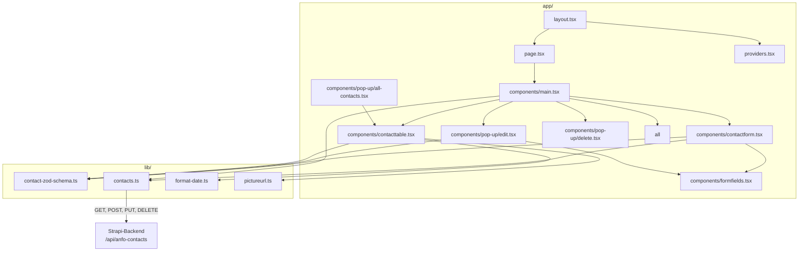
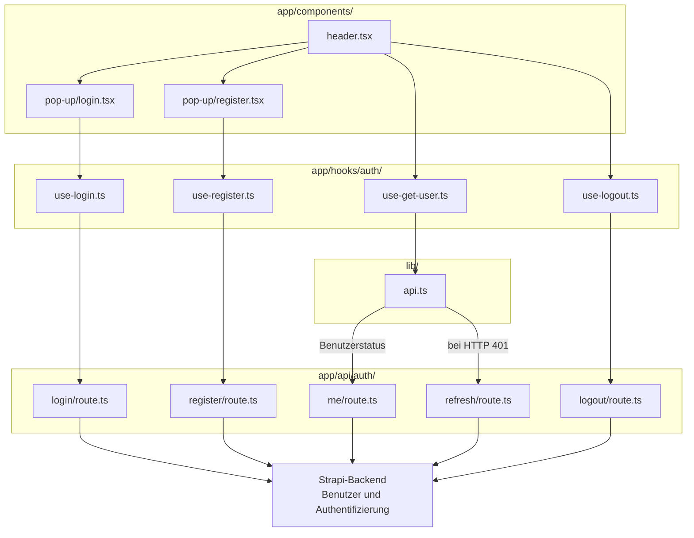

# ANFO – Kontaktverwaltung (Frontend)

Dieses Repository enthält die Benutzeroberfläche der ANFO-Kontaktverwaltung. Es basiert auf Next.js, React und TypeScript. Die Kontakte werden nicht nur im Browser angezeigt: Das Frontend sendet sie an ein separates Strapi-Backend, das die Daten speichert und eine REST-API bereitstellt.

## Verwendete Paketversionen

Die folgende Liste enthält alle direkten Frontend-Abhängigkeiten. Die aufgeführte Version ist die konkrete Version, die in `package-lock.json` festgehalten ist. `package.json` kann stattdessen einen Versionsbereich enthalten, zum Beispiel `^16.4.4`; `npm ci` installiert die Version aus der Lockdatei. Indirekte Abhängigkeiten, die diese Pakete selbst benötigen, sind ebenfalls in `package-lock.json` festgehalten.

### Zur Laufzeit verwendete Pakete

| Paket | Installierte Version | Verwendung |
| --- | --- | --- |
| `@hookform/resolvers` | `5.9.1` | Verbindet React Hook Form mit Zod |
| `@tanstack/react-query` | `5.104.1` | Laden und Zwischenspeichern von API-Daten |
| `axios` | `1.20.0` | HTTP-Anfragen |
| `lucide-react` | `1.65.0` | Symbole in der Benutzeroberfläche |
| `next` | `16.4.4` | Web-Framework, Seiten und Serverrouten |
| `react` | `19.3.0` | Benutzeroberfläche und Komponenten |
| `react-dom` | `19.3.0` | Darstellung von React im Webbrowser |
| `react-hook-form` | `7.89.0` | Verwaltung von Formularen |
| `zod` | `4.6.5` | Prüfung und Beschreibung von Eingabedaten |

### Entwicklungs- und Build-Werkzeuge

| Paket | Installierte Version | Verwendung |
| --- | --- | --- |
| `@tailwindcss/turbopack` | `4.3.3` | Tailwind-CSS-Integration mit Turbopack |
| `@types/node` | `20.19.43` | TypeScript-Typdefinitionen für Node.js |
| `@types/react` | `19.3.0` | TypeScript-Typdefinitionen für React |
| `@types/react-dom` | `19.3.0` | TypeScript-Typdefinitionen für React DOM |
| `eslint` | `8.57.1` | Codeanalyse und Stilprüfung |
| `eslint-config-next` | `14.2.35` | ESLint-Regeln für Next.js |
| `tailwindcss` | `4.3.3` | CSS-Framework für Gestaltung |
| `typescript` | `5.9.3` | TypeScript-Compiler und Typprüfung |

Diese Angaben beschreiben direkte Abhängigkeiten des Frontends und stammen aus der vorhandenen Lockdatei. Das separate Strapi-Backend hat eine eigene `package.json` und eigene Paketversionen. Die Versionen der transitiven Pakete können bei Bedarf in `package-lock.json` nachgeschlagen werden.

**Versionshinweis:** `next` ist auf Version `16.4.4` festgelegt, während `eslint-config-next` aus der `14.2.35`-Reihe stammt. Das ist eine sichtbare Versionsabweichung, die bei einem späteren Update der ESLint-Konfiguration geprüft werden sollte.

## Zusammenspiel mit dem Backend

Es gibt zwei getrennte Projekte:

- **Frontend (dieses Repository):** Seiten, Formulare, Tabellen, Pop-ups und Benutzeroberfläche.
- **Backend:** Strapi-API, Datenmodell, Datenbank, Datei-Uploads und Benutzerverwaltung.

Das Backend liegt im Repository [anfo-backend-master](https://github.com/RaByteCell/anfo-backend-master). Für die vollständige Anwendung müssen Frontend und Backend laufen und miteinander kommunizieren können.

### Was passiert beim Anlegen eines Kontakts?

1. `app/components/contactform.tsx` nimmt die Eingaben entgegen.
2. `lib/contact-zod-schema.ts` enthält die Regeln zur Eingabeprüfung.
3. `lib/contacts.ts` sendet den Kontakt mit Axios an Strapi.
4. Strapi prüft die Anfrage und speichert den Kontakt in der konfigurierten Datenbank.
5. React Query lädt die Kontaktliste erneut, damit die Änderungen sichtbar werden.

Bearbeiten und Löschen verwenden denselben Datenweg. Profilbilder werden über Strapi bereitgestellt.

### Login und Registrierung

Login, Registrierung, Statusabfrage, Token-Erneuerung und Logout laufen über Next.js-Serverrouten in `app/api/auth/`. Diese Routen sprechen mit Strapi. Das Access-Token wird als `httpOnly`-Cookie gespeichert, sodass Browser-JavaScript es nicht direkt auslesen kann. Die Formulare und React-Query-Hooks für diese Funktionen liegen in `app/components/pop-up/` und `app/hooks/auth/`.

## Technologien

| Technologie          | Verwendung                                               |
| -------------------- | -------------------------------------------------------- |
| Next.js              | Seiten, Layout und Serverrouten                          |
| React                | Benutzeroberfläche und interaktive Komponenten           |
| TypeScript           | Typen für Daten und Funktionen                           |
| Tailwind CSS         | Gestaltung                                               |
| React Hook Form      | Eingaben und Formularzustand                             |
| Zod                  | Prüfung von Formulareingaben                             |
| TanStack React Query | Laden, Zwischenspeichern und Aktualisieren von API-Daten |
| Axios                | HTTP-Anfragen an Frontend- und Backend-Routen            |

Die genauen Paketversionen stehen in `package.json`; `package-lock.json` hält die installierten Paketversionen für npm fest.

## Projekt starten

### Voraussetzungen

- Node.js in einer für die installierte Next.js-Version geeigneten Version
- npm
- Das Strapi-Backend aus dem zugehörigen Repository

### 1. Backend vorbereiten und starten

Wechsle in den Backend-Ordner. Folge dort der Backend-README, richte die benötigte `.env` ein und starte Strapi. In der üblichen lokalen Konfiguration läuft Strapi unter `http://localhost:1337`.

### 2. Frontend-Abhängigkeiten installieren

Öffne ein zweites Terminal im Ordner dieses Repositories:

```powershell
cd "C:\Users\Bierbaumer Lukas\Documents\Anmeldeformular\anfo-frontend-master\anfo-frontend-master"
npm ci
```

`npm ci` installiert die Abhängigkeiten anhand der `package-lock.json`. Bei einer erstmaligen Installation kann es einige Minuten dauern.

### 3. Frontend starten

```powershell
npm run dev
```

Öffne danach [http://localhost:3000](http://localhost:3000). Das Entwicklungsfenster muss geöffnet bleiben, solange du die Anwendung verwendest. Beende den Server mit `Ctrl+C`.

## Konfiguration

Das Frontend verwendet folgende optionale Umgebungsvariable:

| Variable              | Verwendung                                                                         | Standardwert                |
| --------------------- | ---------------------------------------------------------------------------------- | --------------------------- |
| `NEXT_PUBLIC_API_URL` | Basisadresse der Strapi-API für Kontakte                                           | `http://localhost:1337/api` |
| `STRAPI_URL`          | Basisadresse von Strapi für Next.js-Serverrouten, einschließlich Authentifizierung | `http://localhost:1337`     |

Für lokale Änderungen kannst du im Frontend-Ordner eine Datei `.env.local` anlegen. Beispiel:

```env
NEXT_PUBLIC_API_URL=http://localhost:1337/api
STRAPI_URL=http://localhost:1337
```

`NEXT_PUBLIC_` bedeutet, dass der Wert auch im Browser verfügbar ist. Dort dürfen keine Passwörter oder geheimen Schlüssel stehen. `STRAPI_URL` wird von den Serverrouten verwendet. Geheimnisse gehören in die passende `.env`-Datei auf dem Server und dürfen nicht in Git eingecheckt oder veröffentlicht werden.

## Projektstruktur

```text
.
├── app/
│   ├── api/
│   │   └── auth/
│   │       ├── login/route.ts
│   │       ├── logout/route.ts
│   │       ├── me/route.ts
│   │       ├── refresh/route.ts
│   │       └── register/route.ts
│   ├── components/
│   │   ├── pop-up/
│   │   │   ├── all-contacts.tsx
│   │   │   ├── delete.tsx
│   │   │   ├── edit.tsx
│   │   │   ├── login.tsx
│   │   │   └── register.tsx
│   │   ├── contactform.tsx
│   │   ├── contacttable.tsx
│   │   ├── footer.tsx
│   │   ├── formfields.tsx
│   │   ├── header.tsx
│   │   └── main.tsx
│   ├── hooks/
│   │   └── auth/
│   │       ├── use-get-user.ts
│   │       ├── use-lock-scroll.ts
│   │       ├── use-login.ts
│   │       ├── use-logout.ts
│   │       └── use-register.ts
│   ├── favicon.ico
│   ├── globals.css
│   ├── layout.tsx
│   ├── page.tsx
│   └── providers.tsx
├── lib/
│   ├── api.ts
│   ├── contact-zod-schema.ts
│   ├── contacts.ts
│   ├── format-date.ts
│   └── pictureurl.ts
├── public/
│   └── logo-generic.svg
├── .env.local              # lokale Konfiguration, nicht in Git einchecken
├── .gitignore
├── AGENTS.md
├── eslint.config.mjs
├── next-env.d.ts           # von Next.js erzeugte Typdeklarationen
├── next.config.ts
├── package.json
├── package-lock.json
├── README.md
└── tsconfig.json
```

Generierte beziehungsweise installierte Ordner wie `.next/`, `node_modules/` und `.git/` sind hier nicht aufgeführt. Sie enthalten Build-Ergebnisse, installierte Pakete beziehungsweise Git-Verwaltungsdaten und gehören nicht zu den eigentlichen Quellcodebereichen.

`app/page.tsx` ist die Startseite. `app/layout.tsx` stellt den gemeinsamen Seitenrahmen mit Header, Footer und `Providers` bereit. `app/components/main.tsx` verbindet Kontaktformular, Tabelle und Pop-ups.

Die Dateien in `app/api/auth/` sind Next.js-Serverrouten: `login` und `register` leiten Zugangsdaten an Strapi weiter, `me` fragt den angemeldeten Benutzer ab, `refresh` erneuert Sitzungstokens und `logout` beendet die Sitzung. Die UI für diese Abläufe liegt in `app/components/pop-up/`; die wiederverwendbaren Authentifizierungsaktionen und -abfragen liegen in `app/hooks/auth/`.

In `lib/contacts.ts` liegen die Kontakt-API-Aufrufe und React-Query-Hooks. `lib/contact-zod-schema.ts` definiert Kontaktfelder, Validierung und TypeScript-Typen. `lib/api.ts` enthält den Axios-Client, der bei einer nicht autorisierten Antwort eine Token-Erneuerung versucht.

### Wie die Dateien zusammenhängen

Die folgenden Grafiken zeigen die wichtigsten Wege durch die Anwendung. Die Rahmen fassen Dateien nach ihren Ordnern zusammen; die Pfeile zeigen, welche Komponente eine andere verwendet oder wohin eine Anfrage gesendet wird.

#### Kontakte



#### Login und Registrierung



Bei den Kontakten bedeutet der Pfeil zur Strapi-API: Die Frontend-Datei sendet eine Anfrage. Bei der Authentifizierung führen die Hooks zuerst zu Next.js-Serverrouten; diese sprechen dann mit Strapi. `api.ts` ist der Sonderfall für die Abfrage des Benutzerstatus: Bei einer HTTP-401-Antwort stößt der Axios-Client die Token-Erneuerung über `refresh/route.ts` an.

Dateien mit `"use client"` enthalten Komponenten oder Hooks, die im Browser laufen müssen, zum Beispiel wegen Formularzustand, Klickereignissen oder React Query. Die Dateien unter `app/api/` laufen serverseitig.

## Nützliche Befehle

Führe die Befehle im Frontend-Ordner aus:

| Befehl          | Bedeutung                                                   |
| --------------- | ----------------------------------------------------------- |
| `npm run dev`   | Entwicklungsserver mit automatischer Aktualisierung starten |
| `npm run lint`  | Code mit ESLint auf bekannte Probleme prüfen                |
| `npm run build` | Produktionsversion erstellen                                |
| `npm start`     | zuvor erstellte Produktionsversion starten                  |

Für eine lokale Produktionsprüfung zuerst `npm run build`, danach `npm start` ausführen.

## Datenprüfung und Zugriff

Die Kontaktregeln in `lib/contact-zod-schema.ts` werden im Frontend angewendet. Das verbessert die Bedienung und zeigt Eingabefehler früh an. Eine Prüfung im Browser ersetzt jedoch keine Prüfung im Backend: Strapi und seine Berechtigungen müssen ebenfalls passend konfiguriert sein.

Kontakte enthalten personenbezogene Angaben wie Adresse, E-Mail und Geburtsdatum. Prüfe deshalb im Strapi-Admin, wer Kontakte lesen, anlegen, bearbeiten und löschen darf. Die Frontend-Oberfläche allein schützt die API nicht.

## Bekannte Grenzen und Hinweise

- Die Kontaktabfrage fordert maximal 100 Einträge an. Die aktuelle Oberfläche ist keine seitenweise paginierte Liste; bei mehr Einträgen muss die Abfrage erweitert werden.
- Die Formulare validieren Daten clientseitig. Notwendige Pflichtfelder und Regeln sollten zusätzlich im Backend abgesichert sein.
- Ein erfolgreicher Login und die Anzeige des angemeldeten Benutzers bedeuten nicht automatisch, dass Kontakt-Endpunkte geschützt sind. Die effektiven Berechtigungen werden im Strapi-Backend festgelegt.
- Die lokale SQLite-Datenbank und hochgeladene Dateien werden vom Backend verwaltet. Sie werden nicht automatisch durch das Frontend gesichert oder übertragen.
- Es gibt derzeit keine automatisierten Testskripte in `package.json`.

## Weiterführende Dokumentation

- [Next.js-Dokumentation](https://nextjs.org/docs)
- [React-Dokumentation](https://react.dev/learn)
- [Strapi-Dokumentation](https://docs.strapi.io/)
- [TanStack Query-Dokumentation](https://tanstack.com/query/latest/docs/framework/react/overview)
- [Zod-Dokumentation](https://zod.dev/)
